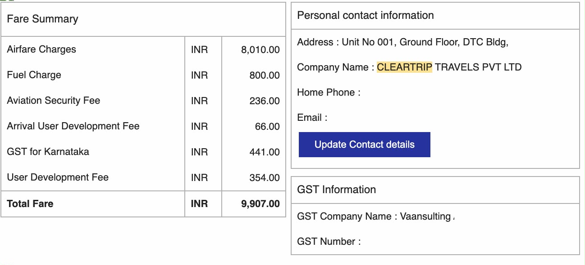
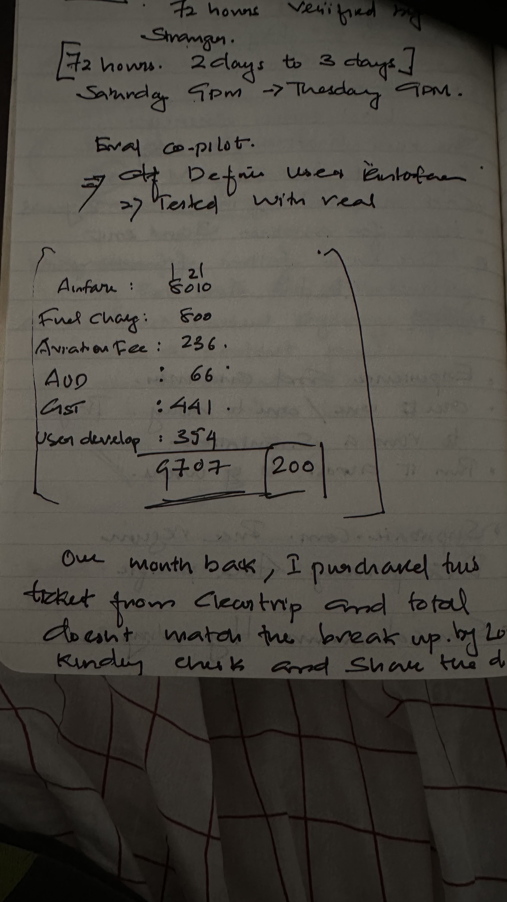
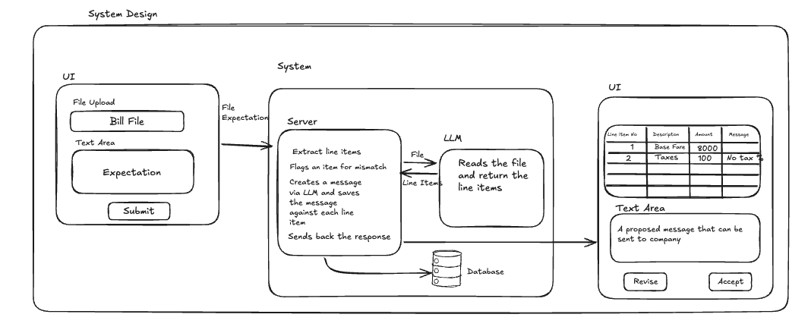
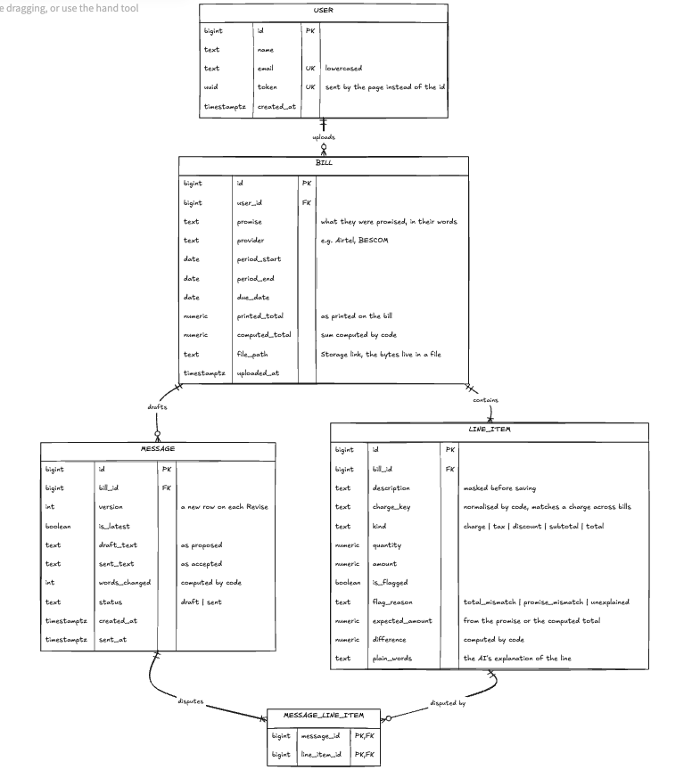

BILLSHIELD SUBMISSION

Name / track: Vineeth Vijayan / Code
Live link: https://billshield-psi.vercel.app/
Public repo: https://github.com/vinu4git/BillShield

MOVE 1, BY HAND
It was a bill from my classmate. He had booked an indigo flight. he saw the fare and but then airline added so many additional charges. Also there was a discrepency of 200.

The message I wrote / did they send it / what they changed: One month back, I purchased this ticket from cleartrip and the total does not match the break up. Kindly check the same and share the details
My classmate wanted it to be changed to "check the bill and let me know if there are any discrepancies."
Golden pairs (link): https://github.com/vinu4git/BillShield/tree/main/goldens
Run `python goldens/run.py` (or `--live` to send the matching and the message through the real model).

Golden pair, a real bill (`goldens/pairs.json`):

| # | Pair | Input (promise → bill) | Golden output | Result |
|---|---|---|---|---|
| 1 | cleartrip-flight | "Airfare ₹8,010, taxes and airport fees extra" → the classmate's Cleartrip fare summary (6 lines, total ₹9,907) | Lines add up to ₹9,907, so the total checks out (my 9,707 by hand was a slip). Fuel Charge ₹800 flagged **unexplained**: the airline sets it, not the government | pass, after a fix: the code used to treat any "fuel" line as a government charge and never flagged it. I took "fuel" out of the rule |

Unit tests, invented bills that each pin one rule of billing.py (`goldens/unit_tests.json`). These are not golden pairs:

| # | Test | Input (promise → bill) | Expected | Result |
|---|---|---|---|---|
| 1 | airtel-addon-pack | "₹499/month, no add-on packs, GST extra" → plan ₹499 + VAS Pack ₹199 + GST | VAS Pack ₹199 flagged **unexplained**; phone number masked as [number] | pass |
| 2 | broadband-price-hike | "₹399/month for 100 Mbps" → Broadband ₹449 + GST | **Wrong**: charged ₹449.00, promised ₹399.00, difference ₹50.00 | pass |
| 3 | electricity-rate-times-units | "₹6.50 per unit" → 200 units charged ₹1,400 | **Wrong**: 200 × ₹6.50 = ₹1,300.00 (code multiplies), difference ₹100.00 | pass |
| 4 | ott-all-clear-with-discount | "₹599/month, ₹50 loyalty discount, GST extra" → ₹599 − ₹50 + GST | No flags. All-clear message, not a complaint | pass |
| 5 | total-off-by-two | "₹499/month, GST extra" → printed total ₹2 more than the lines | **Wrong**: total printed ₹590.82, lines add up to ₹588.82, difference ₹2.00 | pass |
| 6 | cleartrip-misread | The same Cleartrip bill, with the ₹354 User Development Fee missed in reading | Lines miss the printed total by ₹354 (more than ₹5): check the reading, no message drafted | pass |
| 7 | bare-number-promise | "8010" | Follow-up: ask what the price was for before reading the bill | pass |

Next: two more real bills from cohort-mates, as golden pairs.

MOVE 2, NEEDS FIRST
Need list:
1. The bill: a PDF or a photo, under 4 MB.
2. What they were promised, in their own words. Their tone is the voice of the message.
3. Provider (optional): used to track how a provider's promise changes across bills.
4. Confirmation of our reading, but only when we doubt it.
Nothing else. No account number or address: they're masked if they appear.

The follow-up from the replay, and the interface it picked:
- A promise that's only a number ("499", "₹499/-") names a price but not what it was for, so it can't be matched to a line. Interface: an inline hint under the promise box ("Tell us what that price was for, in a sentence…"). The page refocuses the box and doesn't submit.
- If the lines we read miss a printed total by more than ₹5, or the taxes add up to more than all the charges, we don't draft a message. Interface: a check-the-reading screen. The user compares our amounts with their bill and confirms, or uploads a clearer photo. Gaps under ₹1 count as the bill's rounding.

MOVE 3, THE LINE

Code decides (billshield/billing.py):
- Every total, and every difference from the promise. Money is Decimal, never float.
- Which lines get flagged, and why: total_mismatch, promise_mismatch or unexplained.
- Rate × quantity. The model copies the promised rate; code multiplies it.
- Masking emails and long numbers before saving, plus charge_key, which matches the same charge across bills.
- Words changed between the draft and what was sent.
- The no-go guard: every number in a drafted message must appear in the code-written facts or the user's promise. If one doesn't, the model gets one retry naming the bad number. If that fails too, the plain code-written facts go out instead.

AI decides (billshield/llm.py):
- Reading the bill into lines. It copies; it never adds.
- Matching each line to the promise (covered / statutory / carried_over / contradicts / not_covered), and putting each line in plain words.
- The message, in the user's tone.

My call on wrong vs unexplained, and its failure mode:
"Wrong" is something code can prove: the line's price differs from the promised price (promise_mismatch), or a printed total differs from the lines above it (total_mismatch). "Unexplained" is a charge the promise doesn't cover. We don't call it wrong; we ask the company to explain it. These are never flagged as unexplained: ₹0 lines, credits, taxes, statutory charges (by the model's reading, or by name: GST, cess, duty, FPPCA, surcharge…) and carried-over balances.
Failure mode: false negatives hidden as "statutory". A company add-on with a government-sounding name (e.g. "Regulatory Fee", "Fuel surcharge" on a plan that included it) gets waved through. And when the promise is vague, the model can mark a real extra as "covered".

MOVE 4, THE DATA

users → bills → line_items (facts, written once, never versioned)
bills → messages (a new version on each Revise; is_latest; draft_text vs sent_text; words_changed)
messages → message_line_items → line_items  ← THE LINK: which lines a sent message disputes
Each bill keeps the promise it was checked against, so a provider's promise history comes from the bills themselves (no separate promises table).

MOVE 5, WATCH THEM

Evidence: rows from the `messages` table (Supabase), pulled on 24 Oct. Names left out.

**Classmate** (Big Basket grocery bill, 19 Oct)
- Promise typed: "I was promised 20% discount"
- What they did: uploaded the bill, read the draft, pressed Revise once, then pressed Accept on version 2.
- Sent in the app: **yes** (message 19, status `sent`). Words changed: **0**.
- draft_text (v1) and sent_text (v2) are word-for-word the same:

> Hello,
> I'd like to dispute the following on my bill:
> - 'Finish Dishwasher Salt 2 kg' for ₹411.00 is not part of what was promised and is unexplained.
> - 'Handling Charge' for ₹6.00 is not part of what was promised and is unexplained.
> - The bill total is ₹411.00 but the lines add up to ₹417.00, a difference of ₹6.00.
> Please correct this and confirm.
> Thank you.

- What went wrong: the item they bought was flagged as "unexplained", because a discount promise says nothing about products. They asked Revise to make it simpler, but version 2 came back the same: the plain fallback text, which is used when the model's rewrite fails the number check.

**Stranger** (BESCOM electricity bill, 19 Oct)
- Promise typed: "2000"
- What they did: uploaded the bill, pressed Revise once, then pressed Accept on version 2.
- Sent in the app: **yes** (message 24, status `sent`). Words changed: **0**.
- draft_text (v1) and sent_text (v2) are word-for-word the same:

> Hello,
> I'd like to dispute the following on my bill:
> - '8.0 KW Flat Charges' for ₹1,160.00 is not part of what was promised and is unexplained.
> - 'Energy Charges' for ₹1,774.80 is not part of what was promised and is unexplained.
> - 'FPCA Charges' for ₹143.82 is not part of what was promised and is unexplained.
> - 'P & G Surcharge (GCX Portion)' for ₹110.16 is not part of what was promised and is unexplained.
> - 'Net Payable' is printed as ₹3,349.00 but the lines add up to ₹6,537.29, a difference of ₹3,188.29.
> Please correct this and confirm.
> Thank you.

- What went wrong: every line of that message is false. "2000" says a price but not what it is for, so nothing could match it. FPCA and the surcharge are set by the regulator, not BESCOM. And the ₹3,188 gap was our misreading of the bill, not their mistake.

"Sent" means they pressed Accept in BillShield. I did not see either of them send it to the company.

**The surprise:** both people accepted a message with 0 words changed, even though both messages were wrong. People trust a message that looks official and has exact rupee amounts, and they don't check it. So the app must not draft a message it isn't sure of. That's what I changed the next day (commit f62f60d, 20 Oct), and it's where the Move 2 follow-ups come from:
- A bare-number promise like "2000" is now stopped before upload, with a hint asking what the price was for.
- If the lines we read miss the printed total by more than ₹5, no message is drafted. The user checks the reading first.
- Taxes and regulator-set charges (FPCA, surcharges, duty) are no longer flagged as "unexplained".
